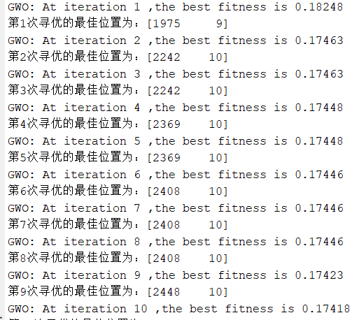
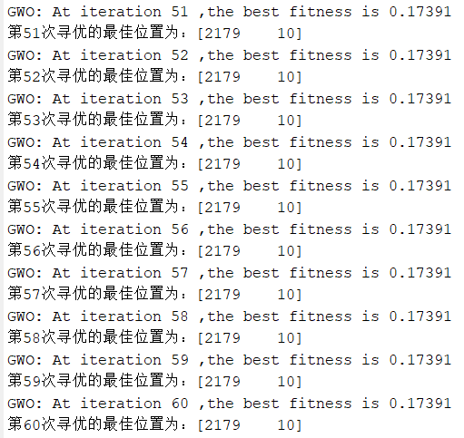
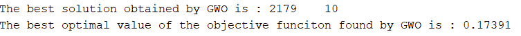
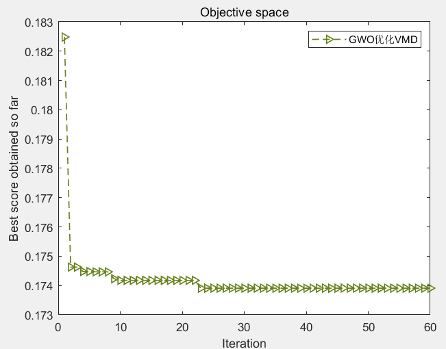
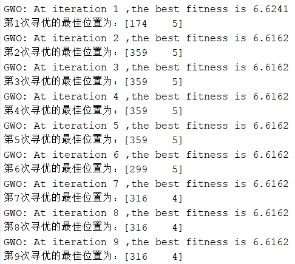
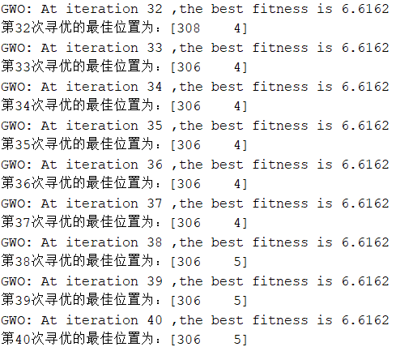
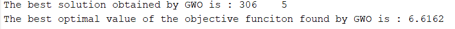
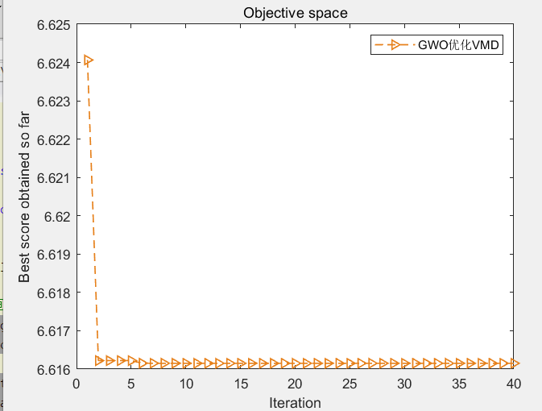

# Grey Wolf Optimization Algorithm (GWO), optimized for VMD, with a fitness function of minimum sample entropy or minimum envelop entropy (can be selected freely, very convenient to modify) including MATLAB

Unlike previous articles, this article considers that there might be instances where the fitness function is based on minimum sample entropy or minimum entropic capacity. In this program, both sample entropy and entropic capacity will be integrated directly. The choice of "1" in the code represents entropic capacity, and "2" represents sample entropy, facilitating easy switching by users.
Next, from a document, the following is an explanation of why sample entropy can also serve as an adaptive function:
The physical meaning of sample entropy is similar to that of approximate entropy, which measures the probability of new patterns appearing in a signal and their complexity. As the likelihood of generating new models increases, this time series becomes more complex. The advantage of sample entropy is that its calculation results are independent of the length of the data, with parameters m and r having equal influence on sample entropy, thus ensuring better consistency. For signal data, the lower the sample entropy value, the higher the self-similarity of the sample sequence; conversely, the more complex the sample sequence becomes.
Taking the Xichu University dataset as an example, select data from X105_BA_time.mat in 105.mat. If there are no data, refer to my article. Xichu University Bearing Data Processing - Attached MATLAB Code_Xichu University Bearing Data Analysis_Today's Blog
Firstly, the VMD is decomposed. The Grey Wolf Optimization (GWO) algorithm is used to optimize two key parameters of VMD (penalty factor α and mode decomposition number K), with the minimization of entropies as the fitness value.
Gray Wolf Optimization Algorithm and previous period's Myxobacterium Optimization Algorithm. The speed is almost the same. This is because the Gray Wolf Optimization Algorithm only calls the objective function once per iteration in the program. As always, First, show the result:
The first result graph is the fitness function based on minimum sample entropy:
​  
The result graph of the fitness function based on minimum entropy is as follows:
​  
Part of the code:
%%\n%% Optimize VMD using SMA algorithm with minimum enclosing entropy or minimum sample entropy as the objective function, to find the optimal two parameters of VMD.\nclear all\nclc\naddpath(genpath(pwd))\nload 105.mat\nD=2;             % Optimize the number of variables\nlb = [100 3];\nub = [2500 10];\ndim = 2;\nMax_iter=40;       % Maximum number of iterations\nSearchAgents_no=15;       % Population size\nxz = 2;  %xz=1 or 2, choose 1 with minimum entropic package as fitness function, choose 2 with minimum sample entropy as fitness function.\nif xz == 1  \n    fobj=@EnvelopeCost;\nelse\n    fobj=@SampleCost;\nend\n\n\nda = X105_DE_time(6001:7000); % Here, select the DEtime data of 105\n[Alpha_score,Alpha_pos,Convergence_curve]=GWO(SearchAgents_no,Max_iter,lb,ub,dim,fobj,da);\n\n\n%Draw fitness function graph\nfigure\nplot(Convergence_curve,'Color',[0.7 0.1 0.1],'Marker','>','LineStyle','--','linewidth',1);\n\n\ntitle('Objective space')\nxlabel('Iteration');\nylabel('Best score obtained so far');\nlegend('GWOOptimizationVMD')\ndisplay(['The best solution obtained by GWO is : ', num2str(round(Alpha_pos))]);  % Output the best location\ndisplay(['The best optimal value of the objective funciton found by GWO is : ', num2str(Alpha_score)]);  % Output the best fitness value\n​Everyone, pay attention to see.xzThis variable, when selected is xz=1, The fitness function is the minimum entropic package, and selection is made. xz=2, The fitness function is based on the minimum sample entropy. This makes it very convenient for everyone to switch.!   
Complete code acquisition: Below the card reply with keyword: GWOVMD  
Feeling good, leave a small like for the blogger! Your small like is the motivation for the blogger to update! Thank you!  
References:  
[1] Li Ying, Wang Peng, Wu Shihu, Ba Peng. Method of fault feature extraction for reciprocating compressor based on AO-VMD [J]. Mechanical and Electrical Engineering, 2023, 40(05):673-681.

## Images

<!-- PAYMENT_BLOCK -->

## Get this dataset

- Payment link (Stripe): [Buy now](https://buy.stripe.com/3cs8yP7sY87d0vu9AB)
- Payment QR code: 

<!-- /PAYMENT_BLOCK -->
